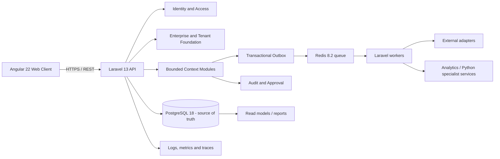

# WP-03 — Enterprise, Tenant, Legal Entity, Organisation, Sites and Identity Architecture

**Package:** WP-03  
**Status:** COMPLETED — target architecture, ownership boundaries, tenant/security model and foundational data dictionary specified  
**Delivery baseline:** Angular 22 + TypeScript 6; Laravel 13 + PHP 8.5; PostgreSQL 18; Redis 8.2; modular monolith; REST/OpenAPI 3.1; transactional outbox.  
**Scope:** WP-03 only. Domain-specific operational tables are defined by the subsequent packages and must reuse these shared identities/keys.

## 1. Architecture decision

Adopt a **shared PostgreSQL cluster and shared relational schema with strict tenant-row isolation**, reinforced by composite tenant keys, PostgreSQL Row-Level Security (RLS), server-side authorization and scoped APIs. The choice is suitable for a multi-tenant ERP where common operations, reporting, product updates and integrations benefit from a consistent schema. Database-per-tenant can be a later deployment tier for customers with legally mandated isolation or unusual scale; it is not the default design.

The transactional application is a **modular monolith**. Domain modules own their write models and expose explicit application services, REST contracts and versioned domain events. There is no cross-module direct table write. PostgreSQL is the system of record. Redis is a cache/queue/short-lived coordination mechanism only. Python is invoked for specialist calculations/analytics through versioned requests; it cannot post operational or financial transactions.

## 2. Logical topology



**Trust zones:** browser is untrusted; API and workers authenticate every request/job; database application role is non-owner and non-superuser; external integrations use isolated credentials and outbound adapters; analytics receives minimized, authorized data. Secrets never appear in source, logs, events, or client bundles.

## 3. Enterprise hierarchy and why the objects are separate

| Object | Meaning / authority | Relationship and non-assumption |
|---|---|---|
| Tenant | Customer boundary for data, configuration, users, policy and subscription | Root ownership boundary; not the same as a legal entity |
| Legal entity | Registered person/body with tax, accounting and statutory identity | A tenant may manage several legal entities; every legal posting belongs to exactly one entity |
| Business unit | Management responsibility or profit/cost responsibility | May group functions without becoming a separate legal person |
| Org unit | Hierarchical department/function such as merchandising, factory, finance or HR | Effective-dated hierarchy; can span sites subject to authorization |
| Business site | Physical or registered address/site: factory campus, office, store premises or depot | A site describes physical location; it is not automatically a warehouse |
| Operational node | Network function: factory, DC, warehouse, store, branch, wholesale depot, office, fulfilment partner or other node | Type plus capabilities; a branch need not hold stock |
| Branch registration | Commercial-register branch entry tied to a legal entity, activity and address | Separate legal evidence; do not infer from an operational node |
| Inventory location | Stock ledger location/zone/bin within an authorized stock-holding node | Only explicit inventory locations can hold balances |
| Brand | Product/market identity | May be associated with one or more legal entities under license/ownership evidence |
| Channel | Route to market: own retail, wholesale, reseller, D2C, marketplace, corporate/B2B, export | Channel is not a legal entity, warehouse or customer |
| Customer/account | Contracting party, buyer, retailer or end customer depending on account type | Distinguish customer account from consumer identity and channel |
| Fulfilment partner | Third party that stores, handles or delivers goods | Contract/custody boundary; not automatically a supplier or warehouse |

A transaction must choose a legal entity where there is a legal/accounting obligation, an operating site/node where physical work occurs, and a channel/account where the commercial event occurs. These identifiers are independently validated.

## 4. Bounded contexts and authoritative ownership

| Context | Owns | Does not own |
|---|---|---|
| Tenant & Enterprise | Tenant, legal entity, business units, org hierarchy, sites, operational nodes, licensing evidence | Stock, journals, employee records |
| Identity & Access | User identity, tenant membership, role, permission, scoped grants, authentication events | Employee contract or payroll |
| Reference & Master Data | UOM, currency, size/color vocabularies, codes, external references and tenant-specific master extensions | Commercial transactions |
| Initiative & Merchandising | Ideas, market insights, brands, seasons, collections, range plans, assortment, pricing plan | Product construction BOM/production route |
| PLM & Product Engineering | Style/variant/SKU, specifications, pattern, tech pack, BOM, fit/sample, release | Stock ledger and shop-floor events |
| Industrial Engineering | Method, operation bulletin, time study, SAM/SMV, capacity and line balance | Actual accepted output |
| Sourcing & Procurement | Supplier qualification, RFQ, PO, contract, material procurement and import documents | Physical stock balance |
| Inventory & WMS | Stock ledger, reservation, location, handling units and movement | AP liability or production quality decision |
| Manufacturing Execution | Production order, routing execution, WIP, bundle genealogy, operator/operation events | Approved standard/SAM master |
| Quality & Compliance | Inspection plans/results, defect, hold/release, CAPA, compliance evidence and HSE cases | Stock transactions except authorized quality disposition commands |
| Commerce & Distribution | Customer/account/channel orders, allocations, fulfilment, POS, delivery, RMA | Financial ledger or stock movement source |
| Finance & Treasury | GL, AP, AR, cash/bank, costing, tax, FX and close | Physical receipt/production source events |
| People & Payroll | Person/employment/assignment, time, leave, skills/training, payroll and benefits | Supplier, reseller or creator classification unless its own domain owns relationship assessment |
| Analytics & Intelligence | Derived facts, KPI definitions, forecasts and recommendations | Authoritative operational transactions |
| Platform & Integration | APIs, outbox/inbox, adapters, idempotency, secrets references, observability | Domain rules, customer master data |

**Dependency rule:** shared kernel stays deliberately small. Domain modules may consume published APIs/events and stable identifiers; they must not query another module's private tables for write decisions.

## 5. Foundational data dictionary (WP-03 ownership)

Conventions: PostgreSQL `uuid` primary keys; UTC `timestamptz`; monetary values use integer minor units or explicit high-precision numeric plus ISO currency code (never binary float); quantities use explicit UOM and scale; source revisions use immutable versions. Business tables include `tenant_id`; legal/financial transactions additionally require `legal_entity_id`. Every tenant-owned table must expose a unique key `(tenant_id, id)` for composite foreign keys.

| Table | Purpose / minimum fields | Important constraints |
|---|---|---|
| tenants | id, code, legal_name, status, locale, timezone, created_at | Unique code; lifecycle status; root ownership |
| tenant_settings | tenant_id, key, value_json, version, effective_at | Unique tenant/key/version; never store secrets as value |
| legal_entities | tenant_id, registration_number, legal_name, legal_form, tax_id, country, fiscal_calendar_id, base_currency, status | Unique registration number per jurisdiction/tenant; legal entity scoped |
| entity_identifiers | tenant_id, legal_entity_id, identifier_type, identifier_value, issuer, valid_from/to | Unique entity/type/value; encrypted or restricted where sensitive |
| business_units | tenant_id, legal_entity_id nullable, code, name, parent_id, responsibility_type | Parent composite FK; does not create legal identity |
| org_units | tenant_id, code, name, org_type, parent_id, owner_user_id, valid_from/to | No cycles; effective-dated tree; owner membership validation |
| business_sites | tenant_id, legal_entity_id, code, site_type, address, geo, timezone, active_from/to | Address must be versioned; never infer inventory capability |
| operational_nodes | tenant_id, legal_entity_id, site_id, node_type, code, name, capabilities_json, status | Node type enum; active site relationship |
| node_relationships | tenant_id, from_node_id, to_node_id, relation_type, valid_from/to | No invalid cycles; typed directed relation |
| branch_registrations | tenant_id, legal_entity_id, site_id, commercial_register_ref, activity_codes, authority, registered_at, status | Licence/branch legal evidence, not node flag |
| business_activities | tenant_id, activity_code, description, industry_class, risk_class | Controlled code list with source/version |
| entity_licences | tenant_id, legal_entity_id, site_id, activity_id, licence_number, issuing_authority, valid_from/to, evidence_asset_id, status | Scoped entity/site/activity and validity overlap check |
| node_capabilities | tenant_id, operational_node_id, capability_code, active_from/to, evidence_id | Branch does not get stock capability by default |
| inventory_locations | tenant_id, operational_node_id, code, location_type, parent_id, allow_stock, status | Node must be stock-capable; unique node/location code |
| brands | tenant_id, brand_code, name, owner_entity_id, status | Legal ownership evidence; brand separate from entity |
| channels | tenant_id, channel_code, channel_type, owner_entity_id, status, policy_version_id | Retail/wholesale/export/channel permission policy link |
| tenant_memberships | tenant_id, user_id, status, joined_at, revoked_at | Unique tenant/user; user may join multiple tenants |
| users | id, email_normalized, name, password_hash/identity_provider_ref, status | Global identity; normalized unique login; never expose hashes |
| identity_credentials | user_id, provider, provider_subject, verified_at, status | Unique provider/subject; secret material not stored in plaintext |
| role_definitions | tenant_id, role_code, name, description, version, status | Tenant role namespaces; platform roles isolated |
| permission_definitions | permission_code, resource, action, classification | Platform registry, stable code |
| role_permission_grants | tenant_id, role_id, permission_code, constraints_json, version | Explicit grant; deny by default |
| membership_role_assignments | tenant_id, membership_id, role_id, scope_type, scope_id, valid_from/to | Composite scope FK; effective-dated |
| access_sessions | user_id, session_ref, created_at, expires_at, revoked_at, auth_strength | Session revoke and MFA/auth strength tracking |
| authentication_events | user_id, tenant_id nullable, event_type, outcome, source, occurred_at, correlation_id | Append-only security events; secrets redacted |
| approval_policies | tenant_id, policy_code, entity_id nullable, activity, threshold, version, effective_from/to | Maker-checker and delegation rules |
| approval_requests | tenant_id, entity_id, object_type, object_id, object_version, policy_version, status, requested_by | State machine; idempotency and scoped approver check |
| approval_decisions | tenant_id, request_id, approver_id, decision, reason, decided_at | Immutable; maker cannot approve restricted action |
| audit_events | tenant_id, actor_user_id, action, object_type/id, scope, occurred_at, correlation_id, before_hash/after_hash | Append-only; redact sensitive values; external archive strategy |
| data_classifications | tenant_id, object_type, classification, purpose, retention_policy_id | Links to privacy/retention policy |
| retention_policies | tenant_id, policy_code, retention_period, trigger, legal_hold_rule, version | Cannot purge records under legal hold |
| legal_sources | jurisdiction, authority, instrument_type, instrument_no, title, gazette_no, publication_date, official_url, checksum, language | Immutable source record and provenance |
| legal_source_versions | source_id, amendment_source_id, relationship, effective_from/to, verified_at, reviewer_status | Explicit amendment chain and metadata discrepancy |
| compliance_applicability | tenant_id, entity_id, site_id, activity_id, source_version_id, determination, rationale, reviewer, valid_from/to | REVIEW REQUIRED never evaluates to active |
| tenant_api_clients | tenant_id, client_id, credential_reference, scopes, status, rotated_at | Secrets referenced through managed vault only |
| idempotency_records | tenant_id, caller_scope, idempotency_key, request_hash, result_ref, expires_at | Unique tenant/caller/key; mismatch rejected |
| outbox_messages | tenant_id, event_id, aggregate_type/id, aggregate_version, event_type/version, payload, occurred_at, published_at | Written in same transaction as aggregate; unique event id |
| inbox_receipts | tenant_id, consumer, event_id, received_at, result_status, error_code | Unique consumer/event; idempotent consumer receipt |
| integration_connections | tenant_id, entity_id nullable, provider, status, config_reference, scopes, last_verified_at | Connector credentials are external secret refs |
| webhook_receipts | tenant_id, provider, provider_event_id, payload_hash, received_at, processing_status | Unique provider/event; signature verified before process |
| attachments | tenant_id, owner_type/id, storage_key, checksum, mime_type, size_bytes, classification, retention_id | Private object storage; signed short-lived access only |
| reference_units | code, dimension, precision, symbol, active | Platform reference table, seeded from controlled source |
| tenant_currency_settings | tenant_id, currency_code, precision, rounding_policy, valid_from/to | ISO currency; no implicit rate |
| exchange_rate_sources | tenant_id, provider_code, authority, source_url, approval_policy | Source and use-specific; no unverified rate |
| exchange_rates | tenant_id, from_currency, to_currency, rate_type, rate, source_id, valid_at | Decimal precision; effective-dated and auditable |
| data_import_jobs | tenant_id, entity_id nullable, import_type, source, mapping_version, state, counts, result_asset_id | Validate/stage before commit; row-level errors |
| data_export_jobs | tenant_id, requested_by, scope, purpose, filter_hash, status, result_asset_id, expiry | Scope, purpose, approval and audit required |

### 5.1 Primary domain table ownership for later packages

These are downstream context-owned tables; WP-03 establishes their tenant/entity keys and shared-reference conventions.

| Package | Context / table families |
|---|---|
| WP-04 | initiatives, insight_sources, market_insights, brand_strategies, seasons, collections, range_plans, assortment_plans, OTB plans, price_lists, promotions |
| WP-05 | product_styles, product_variants, SKUs, size_ranges, measurement_specs, patterns, grade_rules, design_assets, samples, fit_sessions, tech_packs, BOMs, cost_scenarios, product_releases |
| WP-06 | operation_bulletins, operation_standards, time_studies, SAM/SMV versions, resources, machines, shifts, capacity calendars, line_balance_scenarios, preproduction_checklists |
| WP-07 | suppliers, supplier_sites, qualifications, sourcing_events, quotes, awards, purchase_requisitions, purchase_orders, contracts, receipts, material lots, fabric rolls, trim lots, chemical lots, import declarations, landed-cost allocations |
| WP-08 | SOPs, instructions, route_templates, route_versions, route_steps, route_conditions, work-centre capabilities, acknowledgement/training links |
| WP-09 | production_orders, dispatches, cutting_orders, lays, markers, cut_bundles, panels, trim_issues, operation_events, subcontract_custody, wet_process_batches, finish lots, packing_orders, cartons, WIP movements |
| WP-10 | production_targets, hourly_actuals, earned_minutes, downtime, Andon events, skills, assessments, line assignments, incentive policies, incentive earnings, Kaizen/actions, maintenance work orders |
| WP-11 | inspection_plans, inspections, samples, defect_catalogue, defect_events, quality_holds, rework_orders, reinspections, CAPA, compliance_requirements, certificates, HSE hazards/incidents, chemical/waste manifests |
| WP-12 | stock_ledger, stock_balances, handling_units, reservations, transfers, replenishment, sales_orders, order_lines, channel accounts, POS sessions/tenders, marketplace orders, shipments, carrier events, RMA, return dispositions |
| WP-13 | charts_of_accounts, fiscal_periods, ledgers, journals/lines, AP/AR invoices, allocations, payment proposals, bank statements, tax transactions/returns, cost_layers, WIP valuations, FX exposure, reconciliations |
| WP-14 | people, employment, contracts, assignments, time events, rosters, leave, payroll runs, payslips, statutory rule applications, pension contributions, benefits, training, grievances |
| WP-15 | KPI definitions, semantic models, forecasts, recommendations, model versions/evaluations, integration events, reconciliation queues, alerts, SLAs, control-tower cases |

## 6. Tenant enforcement model

### 6.1 Required controls
1. Every tenant-owned table has `tenant_id NOT NULL`, indexed and immutable after insert.
2. Tenant-scoped references use composite foreign keys such as `FOREIGN KEY (tenant_id, legal_entity_id) REFERENCES legal_entities(tenant_id,id)`. Plain FK to a UUID alone is insufficient.
3. Unique business keys are tenant-scoped (e.g. `UNIQUE(tenant_id, code)`).
4. PostgreSQL RLS policies enforce `tenant_id = current_setting('app.current_tenant_id', true)::uuid`. Missing context returns no rows and denies writes.
5. Apply `ENABLE ROW LEVEL SECURITY` and `FORCE ROW LEVEL SECURITY`; the application DB role is not table owner, superuser or `BYPASSRLS`.
6. **Default-deny SQL grants:** do not grant blanket table/sequence privileges through PostgreSQL default privileges. Newly created tables are inaccessible until their migration explicitly grants the smallest required operations after RLS is enabled. Missing grants must fail closed. The runtime role has no rights to update/delete tenants, user identities, memberships, audit events or draft legal entities.
7. Laravel sets tenant context with transaction-local `set_config('app.current_tenant_id', tenant_uuid, true)` only after the authenticated user is authorized for that tenant. The authenticated user UUID is separately set transaction-locally for the self-membership selector policy. Never use persistent session `SET` with pooled connections.
8. API accepts tenant context only through a verified membership/authorized host or trusted token claim; never trust a client-supplied tenant ID.
9. Background jobs carry tenant ID and actor/system identity in signed/validated job context and re-check membership/service scope.
10. Cache keys, file paths, search indexes, exports and event envelopes include tenant scope and are checked at every access boundary.
11. Platform operators use separately audited, time-limited, reason-coded support access; no silent tenant impersonation.
12. Migration credentials are injected only into controlled migration/provisioning processes, never the web runtime environment. A privileged test-fixture connection is declared only in test bootstrap, not the application database configuration.

### 6.2 Illustrative policy pattern

The actual migration must create tenant policies for every tenant table; the following is an architectural pattern to encode in a reviewed migration helper:

```sql
ALTER TABLE legal_entities ENABLE ROW LEVEL SECURITY;
ALTER TABLE legal_entities FORCE ROW LEVEL SECURITY;

CREATE POLICY tenant_isolation_legal_entities
ON legal_entities
USING (
  tenant_id = NULLIF(current_setting('app.current_tenant_id', true), '')::uuid
)
WITH CHECK (
  tenant_id = NULLIF(current_setting('app.current_tenant_id', true), '')::uuid
);
```

Do not use a shared DB owner/application account with RLS bypass. Test with the same non-owner role used by the Laravel runtime. Verify `relrowsecurity` and `relforcerowsecurity`, test missing-context default denial, cross-tenant reads/writes, and role/table/column grants. Every future domain migration must create its tenant RLS policy and explicit grants; no global default grant may silently widen access.

## 7. API and transaction contract

- Resource paths are versioned: `/api/v1/tenants/{tenant}/legal-entities`; the tenant path is validated against authenticated membership before resolving records.
- APIs use request validation, domain commands, explicit DTOs, stable error codes and OpenAPI 3.1 schemas.
- Long-running operations return an operation/resource identifier and a traceable status; no unbounded synchronous request.
- Write commands accept an `Idempotency-Key` for retriable externally originated requests; store request hash and result under tenant/caller scope.
- Approval required? command creates a pending request, not an unauthorized write. The state transition is performed by an independent authorized approver.
- A business transaction writes its aggregate, audit evidence and outbox event atomically. Publishing to Redis or an external system occurs after commit.
- Consumers are idempotent by `event_id`; duplicate delivery is expected and harmless.
- Corrections use explicit reversal/compensation commands; posted facts are not overwritten.

## 8. Identity and access control

### Authentication
Use a proven OAuth2/OIDC-compatible identity layer; support secure password authentication only with modern password hashing, MFA-ready factors and recovery controls. Avoid inventing bespoke cryptographic/token schemes. Browser sessions use secure, HttpOnly, SameSite cookies where same-site browser architecture permits; CSRF is enforced for cookie-authenticated write requests. Tokens have narrow audience/scope and short access lifetime, with refresh rotation/reuse detection when token mode is needed.

### Authorization
RBAC defines stable capabilities; ABAC scopes the grant to tenant, entity, site, department, channel, record classification, amount and time. The authorization decision is made server-side on every command, export and sensitive read. No role implies cross-entity permission by default. Sensitive actions use approval policies and segregation-of-duties checks.

### Minimum security tests
- Cross-tenant read, write, foreign-key linking, object lookup, search, aggregate, export, attachment access, queue processing and analytics query are denied.
- Revoked membership/session/role cannot access or execute later jobs.
- Same user cannot maker-checker approve where prohibited.
- Site/entity scope prevents unauthorized sensitive records even within the same tenant.
- RLS denies all rows when tenant setting is missing and denies mismatched tenant writes.
- Tenant context does not leak between reused database connections/jobs.

## 9. Physical site and channel permission controls

- A branch record requires its commercial-register evidence and notification metadata; an operational branch node alone is not enough.
- A store is a retail operational node only; retail permission is a separate legal activity determination.
- A warehouse/DC must have explicit stock-holding capability and one or more inventory locations; an address or branch is not an inventory location.
- A manufacturing operation does not automatically authorize wholesale or retail. Applicable business licence/activity/site/channel rules come from the legal source registry and professional review.
- A channel order validates selling legal entity, sales activity, customer/account, tax treatment and fulfilment node before release.
- Legal rule applicability is scoped by entity, site, activity, transaction type, jurisdiction and effective date. REVIEW REQUIRED blocks the affected action.

## 10. Reliability, performance and operations

Initial design objectives to be baselined in WP-16, not claimed as measured SLOs:
- Transactional database is the source of truth; a Redis/cache outage cannot lose committed business facts.
- All high-volume list/search endpoints are paginated and tenant-filtered in SQL.
- Queue jobs are idempotent, bounded, retryable and visible in a dead-letter/reconciliation queue.
- PostgreSQL indexes reflect tenant-leading access paths, with compound indexes for common entity/site/date/status filters; avoid unbounded JSON-only business data.
- File assets are stored in private object storage with checksums, version metadata, retention tags and short-lived signed access.
- Logs contain correlation IDs, actor and tenant-safe context but never credentials, tokens, unmasked bank data or unnecessary personal data.
- Backup/recovery, PITR, RPO/RTO, restore test and load tests are explicit WP-16 criteria.

## 11. Architecture decision register

| ADR | Decision | Rationale | Rejected alternative / risk |
|---|---|---|---|
| ADR-001 | Modular monolith | Strong domain boundaries with transactional consistency and simpler operations for initial product | Microservices now would multiply deployments, event failures and operational burden |
| ADR-002 | Shared relational schema with tenant_id + RLS + composite FKs | Efficient tenant-aware domain workflows and strong DB isolation when implemented correctly | Database/schema per tenant adds migration/ops overhead; keep available as premium isolation option |
| ADR-003 | UUID primary keys and tenant-composite unique/FKs | Stable non-sequential identifiers and safe cross-module references | Sequential IDs alone reveal volume and are easier to guess |
| ADR-004 | PostgreSQL is source of truth; Redis is ephemeral support | Preserves consistency and replayable business state | Redis-only inventory or queues as transaction owner risks data loss |
| ADR-005 | Transactional outbox/inbox with idempotent consumers | Prevents lost events and duplicate effects | Direct dual-write to DB and broker is unsafe |
| ADR-006 | User identity separate from employee/person record | A user may be supplier contact, auditor or multi-tenant operator; employment is independent | Making every login an employee would corrupt HR identity semantics |
| ADR-007 | Legal entity/site/branch/node/location/channel are distinct | Enables correct licensing, accounting, physical custody and multi-channel fulfilment | Single “branch/warehouse” table conflates law, commerce and stock |
| ADR-008 | Domain-owned transaction tables and published contracts | Prevents one giant ERP schema with cross-module writes | Shared unrestricted ORM model access causes hidden coupling |

## 12. WP-03 acceptance and handover

**Architecture acceptance conditions**
- The shared entity distinctions above are used by all downstream domain data models.
- All tenant-owned records follow composite tenant FK and RLS rules.
- All financial entries are entity-scoped; inventory is location-scoped; channels are independent.
- Identity is separate from employment. Supplier/customer/reseller/creator/employee are distinct relationships.
- Audit, approval, outbox, idempotency and legal applicability are foundational services.
- The migration and test package must include RLS deny-by-default and cross-tenant tests.

**Implementation status distinction:** this document is the accepted WP-03 target architecture and data dictionary. It does not mean a Laravel migration has been executed or an RLS test has passed. Those require the source/runtime scaffold and CI execution in the following engineering work.

**WP-03 decision:** internally accepted under delegated execution. Proceed to WP-04 initiative, market insight, brand, collection, range and merchandising.
