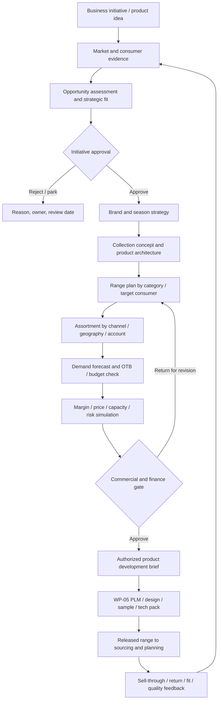

# WP-04 — Initiative, Market Insight, Brand, Collection, Range and Merchandising

**Package:** WP-04  
**Status:** DESIGN COMPLETED — implementation in progress as tested domain vertical slices  
**Scope source:** Approved domain map Domains A and C; Apparel Business Operating System Charter; customer-neutral enterprise and channel principles.  
**Non-goal:** This package does not add a generic CRM/marketing automation product or make buyer orders the only source of demand. It specifies the initiative-to-range-to-channel-commercial workflow that exists before the manufacturing plan.

## 1. Purpose and operating model

Enable an apparel business to decide **what to create, for whom, in which market, at what price/volume, in which season and channel, with what margin and capacity exposure**—before material is purchased or a factory order is released.

The business may be:
- An own-brand product developer launching a collection.
- A manufacturer producing its own collection and/or buyer-owned styles.
- A sourcing/manufacturing buyer who plans ranges for external customers.
- A wholesaler/distributor buying or developing product for accounts.
- An owner of retail stores, outlets, D2C, marketplaces or reseller distribution.
- A group combining these models across legal entities and brands.

A range plan can be demand-led by consumer/store research, a strategic initiative, a wholesale account, an approved buyer forecast, a replenishment need or a combination. Each demand assumption retains its source and confidence. A user-entered quantity is not treated as market evidence.

## 2. Value stream and governance gates

### Gate definitions

| Gate | Entry criteria | Accountable role | Decision | Required evidence / failure |
|---|---|---|---|---|
| G-01 Initiative screening | Named sponsor, idea/problem, initial hypothesis | Strategy/brand director | Approve research, return, park or reject | Rationale, expected benefit, review date; missing sponsor blocks |
| G-02 Evidence sufficiency | Market/consumer evidence, source, recency, geography, target segment | Merchandising/insight lead | Evidence sufficient or collect more | Provenance and confidence; conflicting/weak evidence is shown, not averaged away |
| G-03 Strategic fit | Brand, customer promise, capability, season, channel and risk fit | Business owner | Approve opportunity | Strategy mapping and risk; exceptions require reason |
| G-04 Range freeze | Collection, category architecture, style count, target consumer, price and margin | Product/merchandising director | Freeze or revise range | Approved version; downstream PLM only receives released range lines |
| G-05 Commercial feasibility | OTB, budget/commitment, margin, price, demand, capacity and inventory risk | CFO + commercial director | Approve, conditional, revise or stop | Versioned scenario; budget/OTB breach requires explicit policy exception |
| G-06 Product development handover | Approved range lines and product briefs | Product director | Create WP-05 product-development work | Immutable references to initiative, range, assortment and commercial plan |

## 3. Roles and segregation of duties

| Role | Owns / performs | Cannot silently do |
|---|---|---|
| Initiative sponsor / business owner | Defines opportunity, expected result, accountable benefits | Self-approve an initiative above their delegation |
| Market/consumer insight analyst | Research, survey, store feedback, competitor and trend evidence | Change source evidence after a decision without revision |
| Brand director | Brand positioning, target consumer, brand guardrails, collection intent | Override legal, financial or product compliance holds |
| Merchandising director | Season, category hierarchy, range architecture and assortment | Release unapproved product development briefs |
| Merchandiser / range planner | Style count, depth, size/colour architecture, target price and channel distribution | Commit spend or supplier orders outside authority |
| Demand planner | Forecast by style/category/channel/region/account/time bucket | Replace actual orders/sales/stock with forecast values |
| Pricing analyst | Price architecture and price/margin simulations | Publish a customer/channel price list without approval |
| Finance controller | OTB/budget/commitment and margin policy validation | Modify original sales/cost evidence |
| Commercial approver | Final range and commercial gate within delegation | Approve their own restricted maker transaction |
| Product developer | Accepts brief, creates WP-05 development objects | Alter frozen commercial targets without change/approval |
| Internal auditor | Reviews lineage, assumptions, approvals and outcomes | Create/approve business transactions |

## 4. Core business workflows

### 4.1 Initiative and opportunity lifecycle

State machine:

`DRAFT → SCREENING → RESEARCH → ASSESSMENT → APPROVED → IN_DEVELOPMENT → COMMERCIALIZED → REVIEWED → CLOSED`

Terminal/alternative states: `PARKED`, `REJECTED`, `CANCELLED`. Reopening creates an event and new decision/version; it must not rewrite old approval history.

Minimum process:
1. Sponsor records initiative type (new brand, new collection, category expansion, market entry, product innovation, customer/buyer opportunity, capacity-led opportunity, replenishment, sustainability/quality improvement), target market and intended outcome.
2. Analyst creates evidence items linked to source, date, method, geography, audience, sample size, reliability and permitted use.
3. Assessment records strategic fit, customer/problem, product hypothesis, expected volume/value, target price/margin, investment, sourcing/manufacturing capability, channel fit, compliance risks and major unknowns.
4. Initiative committee records approve / conditional / park / reject decision, decision authority, reason, actions and review date.
5. Approved initiative can spawn one or more season/collection briefs; rejected/parked initiatives remain searchable learning evidence.

### 4.2 Market, consumer, store and channel insight

Insight types:
- Consumer need, fit and size feedback.
- Store observation and sell-through/stockout.
- Wholesale buyer requests and account forecast.
- E-commerce search, conversion, return and product-review signal.
- Competitor assortment, price and promotion.
- Market/season trend, weather/event calendar where relevant.
- Product quality/defect and warranty feedback.
- Supplier/material availability and price movement.
- Production capability, lead time and capacity constraint.

Every evidence record stores: source organization/person/system, original link/document reference, capture method, observation date and extraction date, market/region/store/channel/segment, product/category and style where relevant, sample/denominator, value/unit, confidence, limitation, privacy/purpose basis, analyst and approval status. Store and digital events are not double counted when the same customer interaction appears through multiple feeds.

Analyst must distinguish:
- **Observed fact** (e.g. actual sales and returns).
- **Survey/qualitative evidence** (sample and method disclosed).
- **External benchmark** (source/date/market disclosed).
- **Hypothesis/assumption** (explicitly labelled, owner and test).
- **Forecast/model output** (model version, horizon, confidence and scenario).
- **Decision** (authorized judgement with approver and rationale).

### 4.3 Brand, season and collection planning

Brand strategy records positioning, target consumer, value proposition, quality tier, style language, price architecture, approved categories, market/geography, channel permissions, sustainability/claim substantiation, visual identity and brand protection constraints.

Season records the commercial calendar and lifecycle, not merely the calendar year. Support overlapping design, buy, production and selling seasons; tenant-configured seasons may use fashion, school, uniform, holiday, climate or wholesale delivery calendars. All dates are timezone-aware and can be in Gregorian or approved local calendar display; persisted instants remain normalized.

Collection defines:
- Brand and season, concept/story, target segment and market.
- Category architecture and planned breadth/depth.
- Product families and good/better/best or other tenant-defined tiers.
- Target retail/wholesale prices, cost/margin envelope.
- Key launch/delivery windows and channel availability.
- Assortment principles, carry-over/newness ratio and product lifecycle strategy.
- Sustainability/quality claims with evidence owner.
- Collection budget and risk/contingency.

### 4.4 Range plan and assortment

A range is a governed set of style/product briefs in a season/collection/category. Each range line must identify target style family, consumer need, price tier, target retail and/or wholesale price, target margin, planned units, target channels/markets, launch/delivery window, size and colour intent, new/carry-over status, forecast basis, capacity/sourcing risk and product-development owner.

Assortment is a distribution of the approved range into channel/market/account/location cohorts. It can vary by:
- Channel: own store, wholesale, reseller, marketplace, D2C, export or customer programme.
- Geography / climate / seasonality / store cluster.
- Account tier, customer order or contract.
- Store format, floor-space capacity and sales velocity.
- Size curve / colour depth / pack ratio.
- Launch window and allocation strategy.

The system must preserve the approved core range independently from channel assortment overrides. A channel can opt out or have a restricted assortment but cannot modify the product's approved technical specification.

### 4.5 Demand, forecast and open-to-buy

Forecast demand at an explicit grain (style/variant, category, channel, region, account, store cluster, week/month). Persist the base statistical forecast separately from:
- Manual merchandiser override.
- Approved customer/buyer order.
- Confirmed replenishment.
- Promotion / price / calendar assumption.
- Stockout correction and lost-demand estimate.
- New-style analogue and learning-curve estimate.

Forecasts are versioned with horizon, aggregation, method/model, training data range, forecast owner, confidence/range, scenario assumptions and actual back-test. Users can override forecast only with a reason and retain both model baseline and final consensus.

OTB is a **budget/commitment control**, not one universal arithmetic hard-coded for all tenants. Provide policy-configurable calculation methods, with transparent inputs: beginning inventory at chosen valuation/retail basis; planned sales; markdown/discount; planned ending inventory; purchase commitments/on-order/in-transit; returns; receipts; and seasonal period. Store calculation basis (retail vs cost), currency, timing and policy version. The familiar retail planning formula may be used only where the customer policy confirms it:
`OTB = planned ending inventory + planned sales + planned markdowns - beginning inventory - on-order purchases`
All terms must share the same valuation basis and period; open commitments/receipts are separately reconciled to avoid double count.

Controls:
- Planned purchases cannot silently exceed authorized budget/OTB.
- Purchase orders and contracts are separate financial commitments and later reconcile to actual receipt/AP.
- A range scenario can be tested before commitment.
- Forecast is not treated as purchase authorization.
- Negative OTB or margin breach creates a decision case, not an automatic purchase block if an authorized policy exception exists.
- Actual sales/receipts/returns remain source transactions; forecasts never overwrite them.

### 4.6 Pricing, margin and promotion simulation

Price plans are scoped by legal entity, brand, product/variant, channel, customer/account, market/currency, effective time and tax profile. Price/margin simulations consider approved cost scenario, currency/FX assumptions, expected duties/freight, channel commissions/fees, taxes, markdown and returns. Pricing policies distinguish list price, wholesale price, account net price, promotion, markdown, employee price, reseller tier and campaign offer.

A promotion requires start/end dates, eligible items/accounts/channels, discount type/cap, stack rules, funded-by party, margin floor, budget impact, exclusions, approvals and settlement/reconciliation. Expired or unapproved promotions cannot be used for a new order.

## 5. Domain data model and ownership

### 5.1 Authoritative entities

| Entity/table | Key fields | Owner / relations |
|---|---|---|
| `initiatives` | tenant_id, sponsor_entity_id, code, type, title, objective, target_market, status, owner, expected_benefit, review_date | Business strategy; may link to many insight/evaluation/collection briefs |
| `initiative_versions` | initiative_id, version, hypothesis, scope, target_consumer, target_price, target_volume, investment, assumptions, approvals | Immutable approved initiative snapshots |
| `initiative_decisions` | initiative_id, version, decision, authority, reason, decided_at, action_due | Append-only decision history |
| `insight_sources` | source_type, organization, URI/document reference, method, rights/purpose, reliability | Source provenance and lawful use |
| `market_insights` | type, source_id, observed_at, captured_at, geography, segment, channel, category/style, metric, value, unit, denominator, confidence, limitation | Evidence owner; links initiatives and range decisions |
| `insight_observations` | insight_id, cohort/time bucket, observation dimension, value, evidence_asset_id | Detailed source observation; de-identified when appropriate |
| `brand_strategies` | brand_id, version, positioning, consumer, value_proposition, quality_tier, categories, price_architecture, approved_channels | Brand/product governance |
| `seasons` | tenant_id, code, calendar_type, design_start, buy_start, production_window, delivery_window, selling_window, status | Season calendar, overlaps permitted |
| `collections` | brand_id, season_id, code, concept, target_market, category_architecture, budget, delivery_window, status | Collection owner; links style briefs/range plans |
| `collection_versions` | collection_id, version, story, target consumer, price/margin envelope, approval | Immutable approved collection version |
| `range_plans` | collection_id, version, owner, plan_period, status, approved_at | Controlled collection product assortment |
| `range_lines` | range_plan_id, product_brief_id nullable, category_id, target_tier, planned_units, price_targets, margin_target, channel_scope, launch_window, forecast_ref | Style-level range intent; not yet a fully engineered product SKU |
| `assortment_plans` | range_plan_id, channel_id, market_id, account_id nullable, location_cluster_id nullable, version, status | Channel/market/account allocation intent |
| `assortment_lines` | assortment_plan_id, range_line_id, variant/size_curve_ref, planned_units, launch_date, min/max depth | Channel-specific buy depth and size/color distribution |
| `demand_forecasts` | grain, dimension_refs, time_bucket, quantity, value, method, model_version, horizon, scenario_id, confidence_low/high | Demand planning; forecast not actual order |
| `forecast_adjustments` | forecast_id, baseline, override, delta, reason, evidence_ref, author, approver | Preserves base and human override |
| `otb_policies` | entity_id, budget_basis, formula_version, period, valuation, inclusion_rules, approval_thresholds | Finance-controlled policy |
| `otb_periods` | entity_id, period, currency, beginning_inventory, planned_sales, markdown, planned_ending_inventory, on_order, commitments, actual_receipts, available_budget | Reconciled period values |
| `otb_scenarios` | scenario_id, range_plan_id, demand_version, cost_version, price_version, assumptions, computed_result, sensitivity | What-if analysis; never posts commitment |
| `price_lists` | entity_id, brand/channel/account scope, currency, version, effective_from/to, status | Authorized commercial price book |
| `price_list_lines` | product/variant reference, list price, wholesale price, floor, tax_profile_ref, cost_basis_ref | Product price and margin input |
| `promotions` | scope, type, stack_policy, budget, funded_by, start/end, margin_floor, approval | Controlled offer policy |
| `promotion_eligibility` | promotion_id, product/category/account/channel/location, exclusion | Audience/assortment scope |
| `commercial_decisions` | object_type/id/version, scenario_id, decision, approver, rationale, conditions | End-to-end approval and audit |

All tenant-owned rows use the WP-03 composite tenant key, RLS and entity-scoping patterns. Sensitive consumer evidence is minimized and subject to the privacy/purpose rules defined in WP-02.

### 5.2 Data ownership constraints

- PLM owns engineered product/style/variant/SKU attributes. WP-04 range line may reference a product brief before a style/SKU exists; it must not duplicate PLM product master.
- Finance owns approved cost policies, ledger values and budgets. WP-04 consumes authorized cost/budget snapshots and must not write GL.
- Inventory owns actual on-hand/on-order movements; WP-04 consumes stock/commitment projections with timestamp and staleness.
- Commerce owns actual customer order and sales transactions; WP-04 consumes actuals for analysis.
- Forecast engine owns forecast versions only; a forecast is not a firm purchase order or confirmed customer order.
- Brand and season are shared commercial reference entities, not duplicate style master data.
- Approval service owns decisions and policy evaluation; domains own the object being approved.

## 6. API and event contract

Illustrative versioned endpoints:
- `POST /api/v1/initiatives`; `POST /api/v1/initiatives/{id}/submit`; `POST /api/v1/initiatives/{id}/decisions`.
- `POST /api/v1/insights`; `GET /api/v1/insights?market=&channel=&category=&period=`.
- `POST /api/v1/brands/{id}/strategy-versions`; `POST /api/v1/seasons`; `POST /api/v1/collections`.
- `POST /api/v1/range-plans/{id}/versions`; `POST /api/v1/range-plans/{id}/simulate`; `POST /api/v1/range-plans/{id}/approve`.
- `POST /api/v1/assortment-plans/{id}/simulate`; `POST /api/v1/forecast-runs`; `POST /api/v1/otb-scenarios`.
- `POST /api/v1/price-lists/{id}/submit`; `POST /api/v1/promotions/{id}/approve`.

All writes validate tenant/entity/channel scope, use idempotency where externally retriable, record actor and source version, and return stable error codes. Submit/approve operations are commands; they do not accept arbitrary direct status changes.

Domain event examples (versioned):
- `InitiativeCreated.v1`, `InitiativeDecisionRecorded.v1`, `MarketInsightCaptured.v1`.
- `BrandStrategyApproved.v1`, `CollectionApproved.v1`, `RangePlanFrozen.v1`.
- `AssortmentPlanApproved.v1`, `ForecastPublished.v1`, `OTBScenarioApproved.v1`, `PriceListPublished.v1`.
- `ProductDevelopmentBriefReleased.v1`, `SellThroughFeedbackAvailable.v1`.

Events are written to the transactional outbox with the aggregate revision and tenant scope. No event is published before database commit. Consumers deduplicate by event ID.

## 7. Decision support and KPIs

Role-specific work queues should answer “what decision or action is due?” not merely list records.

| KPI / alert | Definition | Owner / action |
|---|---|---|
| Initiative funnel conversion | Approved initiatives / completed assessed initiatives by type and period | Strategy reviews idea quality and cycle time |
| Evidence sufficiency | Required insight evidence present and current / evidence requirements | Research owner collects missing evidence |
| Range readiness | Approved range lines with complete product briefs / all planned lines | Merchandising addresses missing briefs |
| Range breadth/depth | Styles by category, tier, channel; units per SKU/variant | Merchandiser detects gaps and over-assortment |
| Newness / carry-over mix | New vs carry-over share by category/season | Product director balances development risk |
| Forecast bias / WAPE | Forecast error vs actual sales at declared grain; exclude/annotate stockout effects | Demand planner revises assumptions |
| Sell-through | Units sold / units available for sale over the defined period; returns handled separately | Merchandising reviews product/channel performance |
| Gross margin / contribution margin | Revenue less cost and channel-specific variable charges at stated basis | CFO/pricing owner reviews price or sourcing decision |
| OTB utilization | Authorized commitments / available budget on same basis | Finance alerts before overspend |
| Markdown exposure | Planned/actual markdown against gross margin and inventory age | Merchandiser adjusts replenishment/price |
| Return / fit feedback | Return reasons and fit/quality signals by style/size/channel cohort | Product team raises WP-05/WP-11 follow-up |
| Range-to-capacity fit | Planned demand compared to feasible material/production capacity | Planner adjusts timing/depth before commitment |

No KPI is allowed to conceal denominator, period, channel, tax basis, stockout, return treatment or forecast version. Dashboards link back to source records.

## 8. Exception and risk catalogue

| Exception | Behaviour |
|---|---|
| Evidence contradictory or outdated | Present source-by-source confidence and request new evidence; don't automatically average |
| Initiative rejected or parked | Retain reason and learning; prevent downstream released product-development work |
| Collection date overlaps with another season | Allow overlapping seasons when calendar policy permits; warn on resource/capacity conflict |
| Range has missing target price/cost/margin | Hold commercial gate; allow only explicit conditional approval with owner/action/date |
| Forecast beyond available capacity | Show capacity risk and scenario; no hidden automatic demand suppression |
| Forecast changes after range freeze | Create new forecast version and delta impact; preserve frozen range |
| OTB/budget overspend | Create approval case and show financial effect; no silent budget increase |
| Price floor or margin breach | Hold publish/approval or require authorized exception; retain rationale |
| Channel lacks legal retail/wholesale permission | Block relevant channel activation/order release; route to WP-02 legal task |
| Same customer/order appears in two feeds | Deduplicate using provider event/order identity; retain source cross-reference |
| Store/consumer insight includes personal data | Apply minimization, purpose, access and retention; use cohort aggregates where possible |
| Approved range line requires unavailable material/process | Mark risk and route to WP-06/WP-07 feasibility; do not pretend capacity/supply exists |
| Product brief superseded | Reconcile version change and affected range assumptions before product development handoff |

## 9. Acceptance test catalogue

| Test | Given / when | Expected result |
|---|---|---|
| AT-MER-001 | Sponsor creates an own-brand initiative without customer order | Valid initiative proceeds to screening; no buyer order required |
| AT-MER-002 | Analyst captures store observation and a conflicting external benchmark | Both sources and confidence visible; no destructive overwrite or blind average |
| AT-MER-003 | User changes a brand strategy already used in an approved collection | New version required; historical collection keeps its approved version |
| AT-MER-004 | Merchandiser creates a season, collection and category range | Range lines preserve target consumer, price tier, unit and launch assumptions |
| AT-MER-005 | Planner builds OTB from inventory, sales plan, markdown, ending inventory and commitments | Formula uses one policy and same valuation basis; on-order not double counted |
| AT-MER-006 | Range is allocated to own retail, wholesale and reseller channel | Separate assortment depth and account terms; core product spec unchanged |
| AT-MER-007 | Pricing promotion expires or margin floor is breached | New order cannot use expired promotion; exception requires authorized approval |
| AT-MER-008 | Actual sales/returns feed the next range review | Source actuals retained and feedback linked to next initiative/range decision |
| AT-MER-009 | Forecast override changes published baseline | Original forecast retained; override reason/author/approver and resulting version captured |
| AT-MER-010 | OTB exceeds authorized budget | Approval/exception case raised; no automatic purchase-order creation |
| AT-MER-011 | Retail assortment is planned for a manufacturing entity whose retail permission is unresolved | Plan may be simulated but cannot activate commercial selling |
| AT-MER-012 | Product development requests a frozen range line | Immutable range version and authorized brief passed to WP-05 with lineage |
| AT-MER-013 | A user lacking brand/market/site scope submits a range decision | Server-side authorization denies it and records safe audit evidence |
| AT-MER-014 | A source event is delivered twice | One insight/sales projection effect only; duplicate is recorded/deduplicated |

## 10. WP-04 handover

**Completed:** initiative lifecycle, research evidence model, brand/season/collection governance, range/assortment split, forecast and OTB semantics, price/promotion governance, data ownership, APIs/events, KPI/action model, exceptions and 14 acceptance scenarios.

**Implementation status (22 November 2026):** The design remains the governing scope. Executable tenant-scoped vertical slices now cover initiative, evidence, brand/season/collection, range/assortment, demand/OTB/pricing/promotion workflows and the first merchandising dashboard.

### 10.1 Verified merchandising dashboard slice

- API: `GET /api/v1/product/merchandising-dashboard`, protected by Sanctum `erp:access` and tenant-context middleware; requires `X-Tenant-Id`.
- Angular workspace: route `/product/merchandising-dashboard`, linked from the workspace navigation.
- Tenant-scoped calculated measures: initiative status funnel; latest assessment decision conversion; frozen range lines whose product brief is ACCEPTED with accepted version equal to current version; planned units on frozen range lines; category/target-tier depth; NEW versus carry-over mix; and counts of registered market insight sources/insights.
- Decision queue: visible to OWNER/ADMIN tenant roles only; independent decision items are not offered to their own authors; append-only brand strategy and collection approvals already present in `merchandising_decisions` are excluded from pending work. Personal work includes the signed-in user's active initiatives, briefs and draft range plans.
- Every displayed measure includes its definition and source record names. Planned units are labelled as planned, not sales or demand actuals. Market evidence counts are volume only, not evidence sufficiency.
- Explicitly unavailable until authoritative source records and approved definitions exist: evidence sufficiency; forecast bias/WAPE (requires actual sales and stockout treatment); sell-through; actual gross/contribution margin; OTB utilization against authorized commitments; markdown exposure; returns/fit feedback; and range-to-factory-capacity fit. These are rendered as unavailable rather than zero, forecast, or assumed actual.
- Verification: [GitHub Actions run 45034473384](https://github.com/stocklandethiopia/modern-garment-end-to-end-addis-erp-project/actions/runs/45034473384), commit `bf367c924118ff136f0ed876c34580512e2d0326`: PHP formatting/syntax, Composer audit, PostgreSQL 18 restricted-role migrations, **42 backend tests / 401 assertions**, npm audit, **20 Angular tests across 6 files**, and production frontend build passed.

**Not claimed:** no full AT-MER-001..014 acceptance, sales/stockout/finance/returns/capacity actuals, external channel or market-data live integration, complete initiative-to-sale E2E, staging/UAT or production deployment has been completed by this slice.

**Dependencies:** WP-03 tenant/entity/identity and audit foundation; WP-05 product brief/PLM handoff; WP-06 capacity feasibility; WP-07 sourcing/lead-time constraints; WP-12 actual commerce feedback; WP-13 finance/OTB and cost policies; WP-02 licensing/privacy holds.

**Decision:** internally accepted under delegated execution. Proceed to WP-05 — Design Studio and Product Development.
